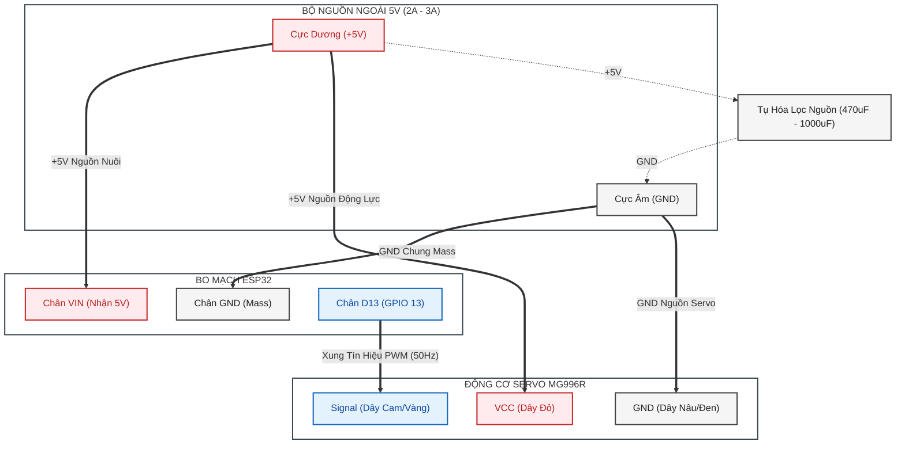

# ESP32 - Điều Khiển Servo MG996R Tốc Độ Cao (Dự Án Bloom)

Dự án điều khiển Servo công suất lớn **MG996R** trên nền tảng vi điều khiển **ESP32** qua giao tiếp **Serial Console**, tối ưu hóa phản hồi tốc độ tối đa (Max Speed) cho cơ cấu nhấn / xịt nước hoa tự động.

---

## 📌 Tính Năng Nổi Bật

- **Tốc độ tối đa (Max Speed):** Servo quay với vận tốc cơ học cực đại từ `0° -> 180°` và hồi tiếp từ `180° -> 0°`.
- **Triệt tiêu lỗi sụt áp (Brownout Detector):** Tối ưu hóa xử lý xung dòng, vô hiệu hóa BOD mềm và quy chuẩn nguồn cấp chống sập ESP32.
- **Điều khiển trực quan qua Serial Console:**
  - Nhấn `1`: Chạy trọn vẹn 1 chu kỳ ép - nhả (`0° -> 180° -> 0°`).
  - Nhấn `0`: Đưa servo ngay lập tức về vị trí gốc (`0°`).
  - Nhập góc tùy ý (`0` đến `180`): Quay tức thì đến góc chỉ định.
- **Gọn nhẹ & Tối giản:** Đã loại bỏ hoàn toàn mã màn hình và cảm ứng để tiết kiệm bộ nhớ, tài nguyên timer và giảm tiêu thụ điện năng.

---

## 🔌 Sơ Đồ Mạch & Kết Nối (Wiring Diagram)

> [!WARNING]
> **CỰC KỲ QUAN TRỌNG VỀ NGUỒN CẤP:**
> Servo **MG996R** là loại nhông kim loại công suất lớn. Khi khởi động hoặc chịu tải, dòng tiêu thụ tức thời có thể đạt **1.5A – 2.5A** cho mỗi servo.
> - **TUYỆT ĐỐI KHÔNG** cấp nguồn servo từ chân `VIN`/`5V` của ESP32 khi cắm cáp USB máy tính (cổng USB chỉ chịu tối đa 500mA - 900mA, sẽ kích hoạt Brownout gây reset liên tục).
> - **BẮT BUỘC** dùng nguồn 5V ngoài riêng (Adapter 5V/3A-5A hoặc mạch Buck hạ áp LM2596/MP1584).
> - **BẮT BUỘC NỐI CHUNG MASS (GND)** giữa nguồn ngoài và chân GND của ESP32.

### 1. Bảng Đấu Nối Dây Thực Tế (1 Servo)

| Nhóm Thiết Bị | Chân Thiết Bị | Màu Dây | Kết Nối Đến | Chức Năng |
| :--- | :--- | :--- | :--- | :--- |
| **ESP32** | **VIN** | - | **Cực Dương (+5V) Nguồn Ngoài** | Cấp nguồn nuôi bo mạch ESP32 |
| **ESP32** | **GND** | - | **Cực Âm (GND) Nguồn Ngoài** | Nối Mass chung cho toàn hệ thống |
| **Servo MG996R** | **VCC** | Đỏ | **Cực Dương (+5V) Nguồn Ngoài** | Cấp nguồn động lực cho servo |
| **Servo MG996R** | **GND** | Nâu / Đen | **Cực Âm (GND) Nguồn Ngoài** | Nối Mass nguồn servo |
| **Servo MG996R** | **Signal** | Cam / Vàng | **ESP32 Chân D13 (GPIO 13)** | Xung PWM điều khiển Servo |
| **Tụ bù áp** | Tụ 470µF - 1000µF | - | Mắc song song giữa `+5V` và `GND` nguồn | Chống sụt áp tức thời khi servo đề-pa |

---

### 2. Sơ Đồ Khối Đấu Nối Chuẩn (Mermaid Diagram)



> **Lưu ý về Cáp USB:**
> - Cáp USB cắm giữa máy tính và ESP32 chỉ dùng để **nạp code (Upload)** và **mở Serial Monitor điều khiển lệnh**.
> - Nguồn nuôi chính cho ESP32 và Servo đều do **Nguồn Ngoài 5V** đảm nhiệm qua chân `VIN` và `GND`.

---

## 🛠 Hướng Dẫn Cài Đặt & Nạp Code (Setup)

### 1. Chuẩn Bị Môi Trường
1. Cài đặt **Visual Studio Code**.
2. Cài đặt Extension **PlatformIO IDE** trên VS Code.
3. Mở thư mục dự án `bloom` bằng VS Code.

### 2. Cấu Hình Thư Viện (`platformio.ini`)
Project sử dụng thư viện `ESP32Servo` để điều khiển xung PWM chính xác phần cứng:
```ini
[env:esp32doit-devkit-v1]
platform = espressif32
board = esp32doit-devkit-v1
framework = arduino
monitor_speed = 115200

lib_deps =
    madhephaestus/ESP32Servo
```

### 3. Biên Dịch & Nạp Code
1. Cắm cáp Micro-USB / Type-C nối kit ESP32 với máy tính.
2. Mở thanh công cụ PlatformIO ở góc dưới màn hình:
   - Nhấn **Build** (biểu tượng dấu `✓`) để biên dịch.
   - Nhấn **Upload** (biểu tượng dấu `→`) để nạp code vào ESP32.
   - Hoặc gõ lệnh trong Terminal:
     ```powershell
     pio run -t upload
     ```

---

## 💻 Hướng Dẫn Sử Dụng Lệnh (Serial Console)

Sau khi nạp firmware, mở **Serial Monitor** với tốc độ **`115200`** baud (có thể dùng Serial Monitor của PlatformIO, Arduino IDE hoặc PuTTY).

Đảm bảo cấu hình Serial Monitor gửi kèm ký tự xuống dòng (`Newline` hoặc `CRLF`).

### Bảng Lệnh Điều Khiển:

| Lệnh Nhập | Hành Động | Mô Tả Chi Tiết |
| :---: | :--- | :--- |
| **`1`** | **Chạy trọn chu kỳ (Max Speed)** | Servo quay hết tốc lực từ `0° -> 180°`, giữ `100ms`, sau đó giật về `0°`. |
| **`0`** | **Về vị trí gốc tức thì** | Đưa servo quay ngay về góc `0°`. |
| **`90`** (hoặc `0` - `180`) | **Quay đến góc tùy chọn** | Nhập số góc mong muốn để servo chuyển động ngay tới góc đó. |

### Ví Dụ Log Xuất Ra Khi Nhập `1`:
```text
>>> [BAT DAU CHU KY] Quay toc do toi da: 0 do -> 180 do -> 0 do <<<
[-] Quay MAX SPEED toi 180 do...
[-] Quay MAX SPEED ve 0 do...
[V] Da hoan tat chu ky ve 0 do!

----------------------------------------------
Nhan '1' de tiep tuc chay chu ky moi.
----------------------------------------------
```

---

## ⚙️ Giải Thích Các Tham Số Cấu Hình Trong Code

Bạn có thể mở file `src/main.cpp` để tinh chỉnh theo cơ cấu cơ khí thực tế:

```cpp
// 1. Số lượng servo kết nối (đổi thành 1 nếu chỉ đang cắm 1 servo test)
const int NUM_SERVOS = 2; 
const int SERVO_PINS[NUM_SERVOS] = {13, 14};

// 2. Dải xung điều khiển MG996R (500us - 2400us tương ứng 0° - 180°)
const int SERVO_MIN_US = 500;
const int SERVO_MAX_US = 2400;

// 3. Thời gian hành trình vật lý tối đa của động cơ
// MG996R mất khoảng 400ms - 600ms để chạy hết góc 180 độ tùy nguồn cấp 5V hay 6V
const int MOVE_TIME_MS = 600; 

// 4. Thời gian giữ ép ở 180 độ trước khi rút về (ms)
// Đặt = 0 nếu muốn vừa chạm góc 180 độ là rút về ngay lập tức
const int HOLD_PEAK_DELAY_MS = 100;
```

---

## ❓ Xử Lý Sự Cố Thường Gặp (Troubleshooting)

1. **Lỗi `Brownout detector was triggered`:**
   - *Hiện tượng:* ESP32 bị reset liên tục khi servo vừa nhúc nhích.
   - *Xử lý:* Cấp nguồn ngoài 5V riêng cho servo (tối thiểu 3A), nối chung mass GND và gắn tụ lọc bù áp 1000µF.
2. **Servo bị rung rè rè, không quay đúng góc:**
   - Kiểm tra xem dây mass GND của nguồn servo đã nối chung với chân GND của ESP32 hay chưa.
   - Kiểm tra dải xung `SERVO_MIN_US` và `SERVO_MAX_US`. Một số loại servo MG996R tương thích tốt nhất ở dải `544us` - `2400us`.
3. **Cơ cấu bị kẹt khi quay tới 180°:**
   - Giảm góc ép trong hàm `runFullCycle()` xuống `160°` hoặc `170°` để tránh servo bị ép kịch trần bánh răng cơ học gây cháy cuộn dây motor.
